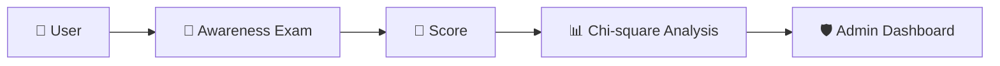

<div align="center">


<b><i>Measure & analyse cybersecurity awareness — Django</i></b>


       

   
</div>

---

## 🛡️ About the Project

A **Django** web application that measures users' **cybersecurity awareness level** through an online exam. Results are stored and analysed — including a **Chi-square test** — so admins can understand awareness trends across users.

## ✨ Key Features

- 👥 Separate **User** and **Admin** portals with registration & login
- 📝 Online **awareness exam** with instant results
- 📊 Dataset view and **Chi-square statistical analysis** of responses
- 🛡️ Admin dashboard to view & activate registered users
- 🔥 Firebase-ready JavaScript integration

## 🧠 How It Works



## 🛠️ Tech Stack

| Layer | Technology |
|---|---|
| Backend | Django (Python) |
| Analysis | Pandas · SciPy (Chi-square) |
| Database | SQLite |
| Frontend | HTML5 · CSS3 · JavaScript · Firebase |

## 📂 Project Structure

```text
├── SecurityAwarenessLevel/   # Django project (settings, urls, views)
├── admins/                   # admin app
├── users/                    # user app (exam, analysis, results)
├── assets/
│   ├── static/  (css, js/firebase.js)
│   └── templates/ (users/, admins/, index, login, register)
├── db.sqlite3
└── manage.py
```

## 🚀 Getting Started

```bash
git clone https://github.com/PreciousBharath/DJANGO-CYBER-SECURITY-AWARENESS-TEST.git
cd DJANGO-CYBER-SECURITY-AWARENESS-TEST
pip install django pandas scipy
python manage.py migrate
python manage.py runserver
```

## 🤝 Contributing

Contributions, issues and feature requests are welcome! Feel free to ⭐ star the repo and open a pull request.

## 👨‍💻 Author

<div align="center">

**Bharath** — Software Developer · Project Engineer · Technical Trainer

<a href="https://github.com/PreciousBharath"></a>
<a href="https://linkedin.com/in/connectbharath"></a>

### 🍔 EAT · 😴 SLEEP · 💻 CODE · 🔁 REPEAT

⭐ **If you found this project useful, give it a star!** ⭐


</div>
